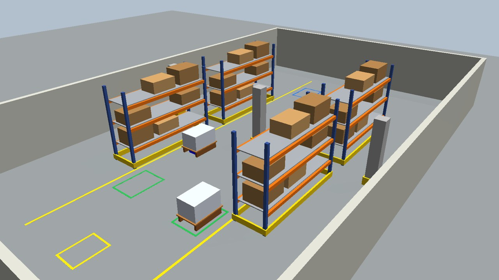
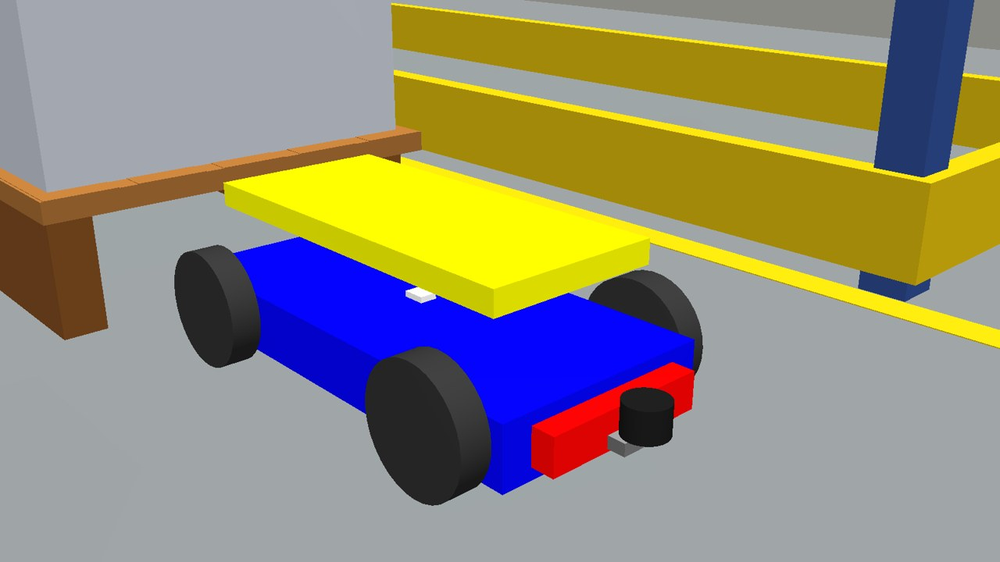
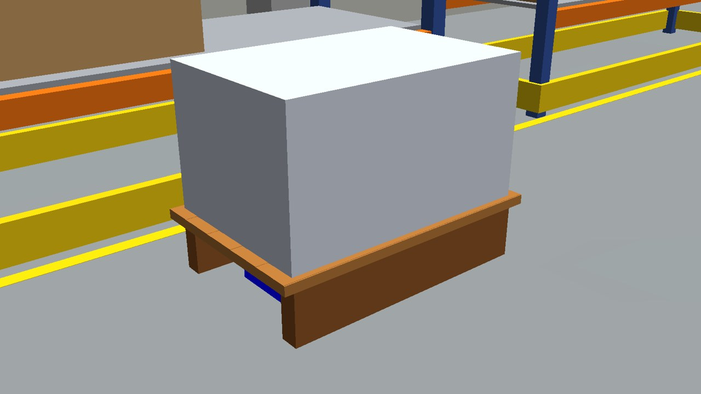
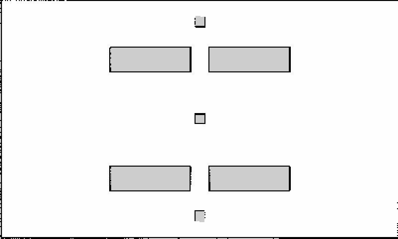
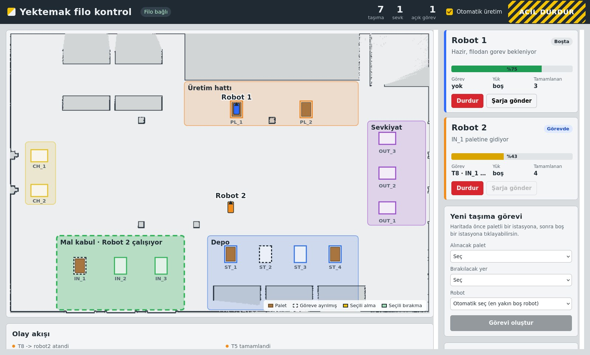

# YEKTEMAK — Otonom Palet Taşıma Robotu (ROS 2 Humble + Gazebo)

Depoda kendi konumunu bulan, paleti LiDAR ile tespit edip altına giren, kaldırıp hedefe taşıyan ve bırakan otonom bir AMR'nin simülasyonu.



| Robot | Yüklü taşıma | SLAM haritası |
|---|---|---|
|  |  |  |

## Ne yapıyor?

Tek komutla robot şu döngüyü insan müdahalesi olmadan tamamlar: park alanından çıkar, Nav2 ile paletin önüne gider, ön LiDAR ile paletin iki rayını bulup konumunu ölçer, rayların arasından paletin altına girer, lift'i kaldırır, yük moduna geçer (büyük footprint, %60 hız), paleti bırakma istasyonuna taşır, indirir, altından çıkar ve sıradaki göreve geçer. Bütün görevler bitince parka döner.

Başsız (headless) Gazebo testinde iki palet görevinin ölçülen sonuçları şöyle: paletin altına girme hatası 0.5 cm'nin altında, bırakma hatası 1–7 cm, parka dönüş hatası yaklaşık 6 cm.

## Filo yönetimi (2 robot + operatör paneli)



36 × 24 m'lik bir fabrikada iki robot, merkezi bir filo yöneticisi ve tarayıcıda çalışan bir React operatör paneli var. Malzeme akışı şöyle: **mal kabul** (IN, tırdan gelen paletler) → **depo** (ST) → **üretim hattı** (PL) → **sevkiyat** (OUT). Ayrıca her robotun bir şarj istasyonu (CH) var.

**Ek kurulum:**

```bash
sudo apt install -y ros-humble-rosbridge-suite
```

**Tek komutla tam demo:**

```bash
ros2 launch yektemak_bringup fleet_demo.launch.py
# tarayıcıda: http://localhost:8080
```

| Argüman | Etkisi |
|---|---|
| `auto:=true` | Otomatik üretim açılışta açık olur |
| `gui:=false` | Gazebo penceresi kapanır, sistem hafifler |
| `rviz:=true` | İki robotu aynı haritada gösteren RViz açılır |

Robotlar ve Nav2 yaklaşık bir dakikada ayağa kalkar. Panelde iki robot kartı "Hazır" olunca görev verebilirsin.

**Panelden neler yapılır?**
- Haritada önce paletli bir istasyona, sonra boş bir istasyona tıkla ve **Görevi oluştur** de. Robot seçmezsen filo, palete en yakın boştaki robotu seçer.
- **Otomatik üretim** açıkken filo akışı kendisi yürütür: mal kabulden depoya, depodan üretime, üretimden sevkiyata. Üretim hattındaki palet 45 sn "işlenir". Sevkiyattaki palet 30 sn sonra tırla gider, mal kabule yeni palet olarak geri gelir. Böylece demo sonsuz döngüde çalışır.
- Robot kartındaki **Durdur** o robotu, üst şeritteki **ACİL DURDUR** bütün filoyu durdurur. Kaldırınca robotlar kaldıkları yerden devam eder.
- Bataryası %30'un altına düşen robota görev verilmez, şarja gider. %80'e gelince tekrar görev alır. Batarya simüle ediliyor: yol aldıkça, yüklüyken daha hızlı düşer.

**Nasıl çalışıyor?**

| Parça | Görevi |
|---|---|
| `yektemak_fleet/fleet_core.py` | Görev kuyruğu, robot seçimi, bölge kilitleri, palet takibi, batarya politikası, otomatik üretim (ROS'tan bağımsız, birim testli) |
| `yektemak_fleet/fleet_manager.py` | Çekirdeği ROS'a bağlar, `/fleet/state` ile durumu saniyede 2 kez yayınlar |
| `yektemak_tasks/robot_agent.py` | Her robotta bir tane: filodan görev alır, Nav2 + LiDAR docking ile yapar, durumunu ve bataryasını bildirir |
| `dashboard/` | React + roslib operatör paneli, rosbridge (port 9090) ile konuşur |

**Bölge kilitleri (trafik yönetimi).** Mal kabul, depo, üretim ve sevkiyat sıraları birer bölgedir. Bir robot bir bölgede palet alırken ya da bırakırken diğer robot o bölgeye girmez: ana koridordaki bekleme noktasında sırasını bekler (panelde bölge kesikli çizgiyle "Robot X çalışıyor" diye görünür). Robot bölgeden 4 m uzaklaşınca kilit sıradaki robota geçer. Bu, dar istasyon sıralarında iki robotun karşı karşıya gelip kilitlenmesini önler. Ana koridorda ise robotlar birbirini LiDAR ile görüp Nav2 ile kaçar.

Bütün mesajlar `std_msgs/String` içinde JSON taşır. Böylece panel ek mesaj paketi derlemeden doğrudan konuşabilir. Komut satırından görev vermek için:

```bash
ros2 topic pub --once /fleet/command std_msgs/msg/String "{data: '{\"cmd\":\"create_task\",\"pick\":\"IN_1\",\"drop\":\"ST_3\"}'}"
ros2 topic echo /fleet/state
```

**Paneli değiştirmek istersen:**

```bash
cd dashboard
npm install
npm run dev          # geliştirme: http://localhost:5173 (simülasyon açıkken)
npm run build        # derleme src/yektemak_fleet/web klasörüne yazılır
cd .. && colcon build --packages-select yektemak_fleet   # derledikten sonra MUTLAKA
```

Derlenmiş panel repoda hazır geliyor, yani sadece kullanmak için Node.js gerekmez.

**Fabrikayı değiştirmek:** `tools/generate_factory.py` dosyasındaki istasyonları, rafları ve duvarları düzenleyip çalıştır. İstasyon listesi `yektemak_fleet/config/stations.yaml` dosyasına da yazılır. Haritayı yeniden çıkarmak için:

```bash
W=$(ros2 pkg prefix yektemak_gazebo)/share/yektemak_gazebo/worlds/factory.world
ros2 launch yektemak_gazebo sim.launch.py world:=$W x:=0 y:=0
ros2 launch yektemak_navigation scan_filter.launch.py
ros2 launch yektemak_navigation slam.launch.py
ros2 run yektemak_tasks map_explorer --ros-args --params-file \
  $(ros2 pkg prefix yektemak_tasks)/share/yektemak_tasks/config/factory_explore.yaml
ros2 run nav2_map_server map_saver_cli -f src/yektemak_navigation/maps/factory
```

**Koridor trafiği.** İki görevdeki robot birbirine 2.4 m'den fazla yaklaşırsa öncelikli olan devam eder, diğeri durup yol verir. Önce yüklü robot geçer, ikisi de aynıysa görevi daha eski olan. Aralarındaki mesafe 3.2 m'yi geçince bekleyen robot devam eder. Panelde bekleyen robotun kartında "Yol veriyor" rozeti ve haritada sarı kesikli halka görünür. Kilitlenmeye karşı bir robot en fazla 25 sn bekletilir. Yol verme sadece Nav2 sürüşünü durdurur, palet altındaki docking ve lift hareketleri asla yarıda kesilmez.

**Önce eski Gazebo'yu kapat.** Daha önceki bir denemeden kalma bir `gzserver` açıksa yeni launch kendi Gazebo'sunu açamaz ve robotları o **eski dünyaya** ekler. Robotlar fabrika haritasıyla başka bir dünyada konum bulmaya çalışır, panelde saçma yerlerde görünür ve tıkanırlar. Launch artık bu durumu algılayıp duruyor ve şu komutu öneriyor:

```bash
killall -9 gzserver gzclient
```

Filo yöneticisi de açılışta Gazebo'da fabrika dünyasının yüklü olduğunu doğrular ve sonucu panelin olay akışına yazar.

**Performans.** Gazebo, iki Nav2 yığını ve rosbridge birlikte ağır bir yük. Bilgisayar zorlanırsa ilk iş `gui:=false` ile Gazebo penceresini kapat, panel haritayı zaten gösteriyor.

## Kurulum (Ubuntu 22.04 + ROS 2 Humble)

```bash
sudo apt update
sudo apt install -y \
  ros-humble-gazebo-ros-pkgs ros-humble-gazebo-ros2-control \
  ros-humble-ros2-controllers ros-humble-xacro \
  ros-humble-joint-state-publisher-gui \
  ros-humble-navigation2 ros-humble-nav2-bringup \
  ros-humble-slam-toolbox ros-humble-laser-filters \
  ros-humble-teleop-twist-keyboard python3-numpy

# Repo kökü doğrudan workspace'tir (içinde src/ var)
git clone https://github.com/genzo61/yektemak-autonomous-pallet-robot-.git ~/yektemak_ws
cd ~/yektemak_ws
source /opt/ros/humble/setup.bash
colcon build --symlink-install
source install/setup.bash
```

## Kullanım

**Tam otonom demo (önerilen):**

```bash
ros2 launch yektemak_bringup sim_mission.launch.py
# başka terminalde durumu izle:
ros2 topic echo /mission/status
```

Çalışırken yeni görev eklemek için:

```bash
ros2 topic pub --once /mission/request std_msgs/msg/String "{data: 'pick_1:drop_2'}"
```

**Sadece navigasyon** (RViz'de "Nav2 Goal" ile hedef verebilirsin):

```bash
ros2 launch yektemak_bringup sim_navigation.launch.py
```

**Haritayı yeniden çıkarma:**

```bash
ros2 launch yektemak_bringup sim_mapping.launch.py
ros2 run yektemak_tasks map_explorer          # robotu rotada otomatik gezdirir
# (ya da: ros2 run teleop_twist_keyboard teleop_twist_keyboard)
ros2 run nav2_map_server map_saver_cli -f src/yektemak_navigation/maps/warehouse
```

Haritayı yeniden çıkarırsan palet istasyonlarını haritadan temizlemen gerekir (aşağıdaki "Tasarım kararları" bölümüne bak).

**Tek robotlu depo demosu (ilk sürüm):** `ros2 launch yektemak_bringup sim_mission.launch.py`

**Elle test komutları:**

```bash
ros2 launch yektemak_gazebo sim.launch.py                    # sadece Gazebo + robot
ros2 launch yektemak_description display.launch.py           # sadece RViz'de model
ros2 topic pub --once /lift_controller/commands std_msgs/msg/Float64MultiArray "{data: [0.10]}"
ros2 service call /pallet_attacher/attach std_srvs/srv/SetBool "{data: true}"
```

`gui:=false` ile Gazebo arayüzü, `rviz:=false` ile RViz kapatılabilir.

## Paketler

| Paket | İçerik |
|---|---|
| `yektemak_description` | URDF/Xacro: gövde, 4 teker, lift (prismatic), ön LiDAR, IMU, ros2_control |
| `yektemak_gazebo` | Depo dünyası, palet ve raf modelleri, simülasyon launch'ı |
| `yektemak_gazebo_plugins` | Palet bağlayıcı Gazebo plugin'i (C++) |
| `yektemak_navigation` | LiDAR filtresi, slam_toolbox, Nav2 parametreleri, harita, RViz |
| `yektemak_tasks` | LiDAR palet tespiti, docking, görev yöneticisi, haritalama gezgini |
| `yektemak_bringup` | Tek robot (mapping / navigation / mission) ve filo (`fleet_sim`, `fleet_demo`) launch dosyaları |
| `yektemak_fleet` | Filo yöneticisi, istasyon/filo ayarları, derlenmiş operatör paneli |
| `dashboard/` | React operatör panelinin kaynak kodu |

Ek olarak `tools/generate_world.py` depo dünyasını, palet ve raf modellerini üretir. Dünyayı değiştirmek istersen ölçüleri bu dosyada düzenleyip çalıştırman yeterli.

## Robot

| Özellik | Değer |
|---|---|
| Gövde | 0.80 × 0.38 × 0.10 m, 80 kg, yerden 4 cm |
| Teker | 4 adet, Ø 0.20 m (dış genişlik 0.48 m) |
| Lift | 0.68 × 0.30 m platform, 0–18 cm strok, PID pozisyon kontrol (palet yerden 14 cm kalkar, raylar LiDAR düzleminin üstüne çıkar) |
| LiDAR | Ön ve arka tampon, yerden 11 cm, her biri ±100°, 20 m |
| IMU | Gövde merkezi, 100 Hz |
| Palet | 1.20 × 0.80 m, iki raylı (iç aralık 0.60 m), yükle 55 kg |

## Tasarım kararları

**LiDAR neden alçakta?** Robot paleti kaldırınca palet tablası robotun üstünü kapatır. LiDAR yukarıda olsaydı yüklüyken kör kalırdı. Yerden 11 cm yükseklikte palet tablasının altında kalıyor ve yüklüyken de görmeye devam ediyor. Bu yükseklikte rafların sadece direkleri görüneceği için raflara zemin seviyesinde sarı koruma bariyerleri eklendi (gerçek depolarda da bulunur).

**İki scan konusu.** `/scan_raw` ham veridir ve docking bunu kullanır, çünkü palet raylarını görmesi gerekir. `/scan` ise robotun etrafındaki palet izdüşümü kutusu çıkarılmış halidir ve SLAM, AMCL ile costmap bunu kullanır. Böylece taşınan paletin rayları "engel" sanılmaz.

**Palet istasyonları haritada boş.** Paletler hareket ettiği için haritaya statik engel olarak girmemeli. Aksi halde robot palet altındayken "başlangıç engel içinde" hatası alınır. Paletleri navigasyon sırasında LiDAR anlık olarak görür.

**Neden planar_move + palet bağlayıcı?** Gazebo'da 4 tekerli skid-steer teması kararsızdır, bu yüzden robotu `gazebo_ros_planar_move` sürer (navigasyon tarafında `vy = 0` tutulur, yani robot diferansiyel sürüşlü gibi davranır). Bu plugin linklerin hızını dışarıdan zorladığı için sürtünme paleti taşıyamıyor. Bu yüzden lift kalkınca `yektemak_gazebo_plugins` paleti eklemle kilitler. Gerçek robotta bu işi yük ağırlığı ve sürtünme yapar, servis yoksa görev yöneticisi bu adımı atlar.

**Docking.** LiDAR iki ray ucunu (aralarında yaklaşık 68 cm) bulur ve aralarındaki açıklığın boş olduğunu doğrular. Bundan palet merkezini ve yönünü hesaplar. Robot palet ekseni boyunca Stanley benzeri bir kontrolcüyle ilerler. Raylara girmeden önce bir hizalama kapısı vardır: yanal hata 3.5 cm'den ya da açı hatası 3°'den büyükse robot geri çekilir, paleti yeniden ölçer ve tekrar dener. Algoritmanın birim testleri `yektemak_tasks/test` altında, `python3 -m pytest src/yektemak_tasks/test` ile çalışır.

## Bilinen tuzaklar (bunlarla karşılaştık)

1. **URDF yorumlarında `: ` ve `'` kullanma.** gazebo_ros2_control robot tanımını YAML olarak parse eder. `<!-- IMU: gövde -->` gibi masum bir yorum bile "Couldn't parse parameter override rule" hatasıyla her şeyi çökertir.
2. **Launch argüman adları çakışabilir.** `gzserver.launch.py` da `params_file` adlı bir argüman tanımlıyor. ROS 2'de launch argümanları include'lar arasında paylaşıldığı için senin argümanın sessizce ezilir. Bu yüzden argümanlar `slam_params_file` ve `nav2_params_file` olarak adlandırıldı.
3. **Lift PID'i yükü kaldıracak kadar güçlü olmalı.** Düşük kazançla lift 55 kg yük altında sadece 4 cm kalkıyordu. Kazançlar `yektemak_ros2_control.xacro` içinde.
4. **planar_move ile teker sürtünmesi düşük olmalı**, aksi halde tekerler fren yapar ve yüklü robot devrilmeye çalışır.
5. **Çoklu robotta Gazebo eklenti namespace'i güvenilir değil.** İkinci robotun `planar_move` ve sensör eklentileri ilk robotun namespace'inde açılıyor, iki robotun odometrisi aynı topic'e akıyordu. Bu yüzden bu eklentilerde topic'ler mutlak adla veriliyor (`/robot2/odom` gibi). Sensör ve eklenti adları da robota özel.
6. **Panel derlemesinden sonra `colcon build`.** `npm run build` dosya adlarını değiştirir, ROS paketinin kurulu kopyası güncellenmezse panel boş sayfa açar.

## Gerçek robota geçiş için notlar

Simülasyondaki arayüzler gerçek robotta da aynı kalacak şekilde seçildi: `/cmd_vel`, `/odom`, `/scan_raw`, `/imu/data` ve `/lift_controller/commands`. Gerçek tarafta yapılacaklar şunlar:
- Motor ve lift sürücüleri için bir `ros2_control` hardware interface'i yazmak (CANopen veya RS485 sürücüler ya da bir STM32 köprüsü).
- Gerçek LiDAR'ın sürücüsünü `/scan_raw` olarak yayınlamak.
- Odometri ile IMU'yu `robot_localization` EKF ile birleştirmek.
- Güvenlik katmanını (acil durdurma, güvenlik lazer alanları, watchdog) eklemek.
